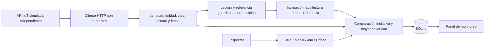

# Arquitectura vigente — EV2 del 22/10/2026

## Etapa configurable de presentación

`app.create_app` toma `PROJECT_STAGE` de la configuración explícita o del entorno y valida dos valores: `cutoff_2026_10_26` (predeterminado) y `full`. `cutoff_mode()` es la comprobación central compartida por control de rutas, dashboard, recepción, inspecciones y contexto Jinja. No depende de la fecha del ordenador ni de archivos de gestión.

El `before_request stage_access` bloquea rutas futuras antes de sesión/CSRF/SQLite. La recepción valida y persiste los mismos datos EV2, pero en corte omite la consulta de reglas y `evaluate`; la función también se protege como defensa adicional. Inspecciones rechaza `plan_id` antes de escrituras y omite evaluación. Las plantillas alternan menú, inicio, accesos y programación. Web, CLI y worker comparten `create_app` y deben arrancar con la misma etapa. Cambiar de modo no escribe datos ni reevalúa históricos. Los apartados siguientes conservan la arquitectura del modo completo.

En local se mantienen Flask/Jinja, SQLite, archivos fotográficos privados, proveedor HTTP independiente y worker periódico. La publicación usa PostgreSQL y Storage privados en Supabase, Flask en Vercel y Cron remoto; véase [arquitectura de nube](SUPABASE_VERCEL.md). Los cambios se concentran en el modelo de evaluación y presentación.

`KINDS` identifica unidades canónicas (m/s² para aceleración vertical pico y ° para inclinación). El proveedor entrega lectura bruta; la referencia se obtiene de la base, administrada por DOM, no de un campo no confiable del proveedor. `measurements` guarda referencia y variación de cada lectura EV2. Se resta con Decimal antes de convertir el resultado finito a almacenamiento REAL para conservar límites decimales exactos.

`config/ev2_pilot.json` configura los supuestos iniciales. `configure-ev2-demo` agrega componentes y configuraciones que no existen, sin sensores adicionales ni modificación de referencias definidas. `app.rules` valida finitud, no negatividad y orden de niveles y versiona reglas al guardar. `evaluate` filtra reglas activas EV2, compara >= y selecciona una sola severidad máxima, vinculando alerta/regla/medición. Visuales se comparan por condición exacta y también conservan la regla generadora. Una alerta no es diagnóstico estructural y las tareas no cambian su estado automáticamente.

## Migraciones e históricos

`schema.sql` conserva el bootstrap original; `migrations.py` agrega campos previos y llama a `ev2_migration.py`. EV2 agrega reference_value/previous_unit a sensores, reference_value/variation/specification a mediciones, standard/severity/unit a reglas, standard/severity a alertas y standard a inspecciones.

La ampliación del CHECK de inspecciones utiliza una nueva tabla con columnas originales, copia por nombre de columnas, conserva IDs, sustituye la tabla y comprueba foreign_key_check dentro de una transacción. La desactivación temporal de FK se limita a la migración y se restaura al finalizar. No se eliminan registros ni archivos, ni se cambia el valor/unidad de mediciones anteriores. Su specification queda historica; no se calcula retroactivamente la variación. Las categorías visuales anteriores se conservan sin equivalencia automática. Las reglas históricas no evalúan registros EV2; alertas pasadas conservan relaciones y no reciben una severidad inventada.

El cambio de unidad de configuración de sensores de vibración solo afecta a capturas nuevas; previous_unit conserva la configuración anterior. No es una conversión física. La actualización se aplica con web y worker detenidos y respaldo completo previo.

## Captura y seguridad

Manual y automática comparten validaciones y deduplicación. BEGIN IMMEDIATE serializa la recepción; savepoints evitan filas/alertas parciales por elemento. El worker es un proceso independiente con bloqueo de SO, configuración de intervalo, recuperación tras errores y conexiones cerradas por ciclo. Auditoría registra identidad/motivo de rechazos; fallos que impidan auditar se registran por logging.

Se mantienen autenticación, permisos, CSRF, CSP, carga fotográfica validada, relaciones de programación y mantenimiento y trazabilidad. La UI usa los mismos registros y una única indicación de demostración. Los mockups se construyen desde estas plantillas y datos temporales.

Fechas documentales: 24/11/2026 término de EDT 1.4.5/1.4.6; 26/11/2026 presentación. El alcance cuantitativo EV2 prevalece sobre documentación histórica. No se declara proveedor real, validación externa ni aceptación HU-09.
