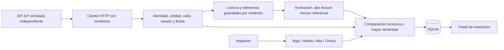

# Arquitectura vigente — especificación EV2 y etapas EV3

## Navegación, paginación y avisos EV3

Se conservan los feature flags y todos los contratos de recepción/evaluación. `/measurements` y `/alerts` siguen siendo vistas separadas. El detalle de medición consulta sus alertas solo si la etapa las habilita. Reglas no cambia su motor: la separación se realiza en Jinja a partir de active y standard.

Alertas e historial ejecutan COUNT más SELECT con LIMIT 20/OFFSET, ordenados por created_at DESC,id DESC; las páginas fuera de rango se ajustan a la última, los parámetros inválidos se rechazan y los filtros se conservan en los enlaces. No hay paginación cosmética en JavaScript.

GET `/api/v1/alert-notifications` exige sesión y rol DOM/Inspector/Mantención. En EV2 se bloquea antes de acceder a BD. Cada consulta obtiene abiertas (Activa/En atención) y último ID con un agregado; solo si hay IDs posteriores hace un segundo SELECT limitado a 20. La primera consulta fija una línea base sin avisos históricos. El cursor se conserva por usuario/etapa/sesión de login en sessionStorage de la pestaña. El identificador de sesión de avisos rota al autenticar y la respuesta se comprueba para impedir consumir una sesión cambiada.

Cliente sin dependencias externas: consulta cada 30 s, timeout de 8 s, sin solapamiento, pausa de consultas en pestaña oculta, reintento de fallos transitorios y detención ante 401/403 o cambio de sesión. Usa textContent para contenido y enlaces locales por ID. No existe estado de lectura, nueva tabla ni escritura de históricos. Ver [regresiones y límites](REVISION_EV3_UI.md).

## Etapa configurable de presentación

`app.create_app` toma `PROJECT_STAGE` de la configuración explícita o del entorno y valida tres valores: `cutoff_2026_10_26` (predeterminado), `cutoff_2026_11_09` y `full`. `STAGE_FEATURES` y `feature_enabled()` centralizan las funciones disponibles para rutas, inicio, recepción, inspecciones y contexto Jinja; `cutoff_mode()` conserva su significado original de EV2. No depende del reloj ni de archivos de gestión.

| Etapa | alerts (reglas/evaluación/seguimiento) | advanced_dashboard | maintenance | inspection_plans |
|---|---|---|---|---|
| `cutoff_2026_10_26` | No | No | No | No |
| `cutoff_2026_11_09` | Sí | No | No | No |
| `full` | Sí | Sí | Sí | Sí |

El `before_request stage_access` bloquea por función las rutas futuras antes de sesión/CSRF/base de datos. EV2 conserva recepción sin consulta de reglas ni evaluación. EV3 usa la misma recepción y motor de full, sin duplicar validaciones ni cambiar esquema, reglas o unidades: mediciones válidas evaluables e inspecciones nuevas generan alertas con la versión activa correspondiente. La ausencia de regla/referencia y las lecturas inválidas/no disponibles mantienen sus resultados existentes sin alertas.

En ambos cortes las inspecciones rechazan `plan_id` antes de escrituras/fotos y omiten la consulta de programaciones. El detalle de alerta EV3 no consulta tareas ni muestra mantenimiento; sus notas y estados funcionan independientemente. El inicio EV3 usa solo el resumen básico, sin consultas del panel avanzado. No existe dependencia indispensable con EDT 1.4.5/1.4.6 o inspecciones programadas.

Web, CLI y worker comparten `create_app` y deben arrancar con la misma etapa. Cambiar de modo no escribe datos ni reevalúa históricos. No hay migración ni cambio automático de configuración productiva para B-11. Los apartados siguientes describen las capacidades conservadas de full; [reportes B-11](REPORTE_1_5_2_3_REGLAS_ALERTA.md) documentan el alcance intermedio.

En local se mantienen Flask/Jinja, SQLite, archivos fotográficos privados, proveedor HTTP independiente y worker periódico. La publicación usa PostgreSQL y Storage privados en Supabase, Flask en Vercel y Cron remoto; véase [arquitectura de nube](SUPABASE_VERCEL.md). Los cambios se concentran en el modelo de evaluación y presentación.

`KINDS` identifica unidades canónicas (m/s² para aceleración vertical pico y ° para inclinación). El proveedor entrega lectura bruta; la referencia se obtiene de la base, administrada por DOM, no de un campo no confiable del proveedor. `measurements` guarda referencia y variación de cada lectura EV2. Se resta con Decimal antes de convertir el resultado finito a almacenamiento REAL para conservar límites decimales exactos.

`config/ev2_pilot.json` configura los supuestos iniciales. `configure-ev2-demo` agrega componentes y configuraciones que no existen, sin sensores adicionales ni modificación de referencias definidas. `app.rules` valida finitud, no negatividad y orden de niveles y versiona reglas al guardar. `evaluate` filtra reglas activas EV2, compara >= y selecciona una sola severidad máxima, vinculando alerta/regla/medición. Visuales se comparan por condición exacta y también conservan la regla generadora. Una alerta no es diagnóstico estructural y las tareas no cambian su estado automáticamente.

## Migraciones e históricos

`schema.sql` conserva el bootstrap original; `migrations.py` agrega campos previos y llama a `ev2_migration.py`. EV2 agrega reference_value/previous_unit a sensores, reference_value/variation/specification a mediciones, standard/severity/unit a reglas, standard/severity a alertas y standard a inspecciones.

La ampliación del CHECK de inspecciones utiliza una nueva tabla con columnas originales, copia por nombre de columnas, conserva IDs, sustituye la tabla y comprueba foreign_key_check dentro de una transacción. La desactivación temporal de FK se limita a la migración y se restaura al finalizar. No se eliminan registros ni archivos, ni se cambia el valor/unidad de mediciones anteriores. Su specification queda historica; no se calcula retroactivamente la variación. Las categorías visuales anteriores se conservan sin equivalencia automática. Las reglas históricas no evalúan registros EV2; alertas pasadas conservan relaciones y no reciben una severidad inventada.

El cambio de unidad de configuración de sensores de vibración solo afecta a capturas nuevas; previous_unit conserva la configuración anterior. No es una conversión física. La actualización se aplica con web y worker detenidos y respaldo completo previo.

## Captura y seguridad

Manual y automática comparten validaciones y deduplicación. BEGIN IMMEDIATE serializa la recepción; savepoints evitan filas/alertas parciales por elemento. El worker es un proceso independiente con bloqueo de SO, configuración de intervalo, recuperación tras errores y conexiones cerradas por ciclo. Auditoría registra identidad/motivo de rechazos; fallos que impidan auditar se registran por logging.

Se mantienen autenticación, permisos, CSRF, CSP, carga fotográfica validada, relaciones de programación y mantenimiento y trazabilidad. La UI usa los mismos registros y una única indicación de demostración. Los mockups se construyen desde estas plantillas y datos temporales.

Fechas documentales: 24/11/2026 término de EDT 1.4.5/1.4.6; 26/11/2026 presentación. El alcance cuantitativo EV2 prevalece sobre documentación histórica. No se declara proveedor real, validación externa ni aceptación HU-09.
