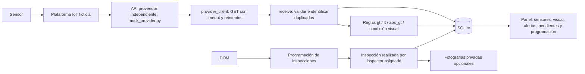

# Arquitectura corregida

Se mantienen Flask, Jinja, SQLite y el almacenamiento privado de fotografías.

`mock_provider.py` sirve HTTP en otro proceso/puerto; el sistema municipal consulta `/measurements` mediante URL configurable y Bearer opcional. El proveedor simulado genera un lote estable para ambos puentes. La prueba usa servidores HTTP reales en puertos efímeros y el cliente municipal real. No se declara conectividad con hardware o proveedor real.

La consulta manual DOM y el comando `pull-provider` comparten lógica. Retries solo para errores transitorios de transporte/429/5xx. Cada elemento usa savepoint; un registro inválido no deja medición ni alertas parciales. Se comprueba ID externo único antes de insertar y se conserva la restricción UNIQUE en SQLite. Se mantiene la API POST receptora como alternativa compatible.

`migrations.migrate` agrega columnas y tabla sin reconstruir ni eliminar datos. Se ejecuta al abrir la conexión y también mediante `migrate-db`; `init-db` inicializa instalaciones nuevas. `schema.sql` conserva el esquema base para probar migración desde la versión anterior. La tabla de programación referencia puente/componente/inspector y el resultado real único. Solo el inspector asignado registra ese resultado; el puente/componente deben coincidir y el plan estar programado. Todas las operaciones relevantes se auditan.

Las reglas antiguas conservan `gt`. Para el piloto se documenta `abs_gt` en inclinación: abs(valor) > umbral académico. `lt` permite umbrales negativos. Igualdad no dispara alerta. Una medición sin regla activa del mismo puente y variable informa «Sin regla aplicable». Datos históricos conservan un estado de evaluación explícitamente histórico. Las reglas académicas del formulario siempre llevan marca ficticia.

Panel de sensores y panel visual separados, pendientes de mantenimiento filtrados por rol, programación pendiente y última inspección por puente. Filtros por puente no evaden permisos. Las relaciones alerta-inspección son explícitas: origen o nota; alerta-tarea mediante FK. Cierre de alerta sigue siendo exclusivamente DOM con justificación.

Término EDT 1.4.5/1.4.6: **24/11/2026**. Presentación académica: **26/11/2026**.
