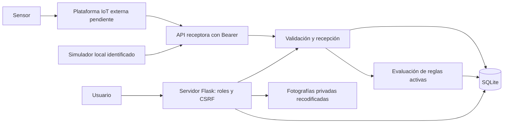

# Arquitectura

Aplicación monolítica Flask, plantillas Jinja, HTML/CSS/JavaScript progresivo y SQLite con claves foráneas. Esta arquitectura evita servicios innecesarios para dos puentes y permite demostrar persistencia, fotografías y roles sin proveedor IoT.

Entidades: puente → componentes → sensores → mediciones; puente/componente → inspecciones → fotografías; puente → reglas → alertas → notas e inspecciones vinculadas; puente/componente/alerta → tareas → usuario responsable; auditoría transversal. La tabla `alerts` conserva el ID de medición o inspección que originó la detección. Se conserva la regla original al desactivarla. El historial y las mediciones no se editan; las correcciones se agregan como nuevos registros.

API, formulario de simulación y reglas comparten `receive`/`evaluate`. La transacción incluye medición, alertas y auditoría. El ID externo es único para evitar duplicación al reintentar; una repetición devuelve 400 sin insertar de nuevo. Inspecciones validan todas las imágenes antes de guardar, y eliminan los archivos generados si una validación de base falla. Los archivos no son parte del árbol público de estáticos.

Contrato de proveedor, conversión de unidades si fueran distintas, frecuencia y frescura de capturas, certificados y umbrales estructurales deben acordarse con terceros. No se implementan modelos predictivos ni instalación de hardware.
